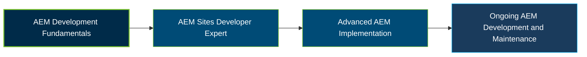

# Adobe Experience Manager Sites Developer Expert Certification Exam Guide

A dedicated, comprehensive study guide and technical reference repository for candidates preparing for the **Adobe Experience Manager Sites Developer Expert Certification Exam (AD0-E137)**.

---

## Exam Overview

The Adobe Experience Manager Sites Developer Expert certification validates advanced application development skills across AEM configuration, component development, deployment workflows, and environment maintenance.

- **Exam Format**: Online proctored certification exam.
- **Target Audience**: Senior Adobe Experience Manager Developers and Adobe Experience Manager Developers.
- **Prerequisites**: Adobe recommends at least 12 months of AEM Platform experience, advanced component development skills, and an understanding of MVC and the AEM development lifecycle.

---

## Core Exam Domains & Knowledge Areas

### 1. Configurations

- Dispatcher rules, multi-tenancy, and AEM configuration.
- SAML and LDAP integration, replication agents, and editable templates.
- Content fragment models and configuration management.

### 2. AEM Development

- SPA structures, Sling Model Exporter, templates, and components.
- Custom components using HTL, Sling Models, services, OSGi services, and servlets.
- Unit testing, mock data, third-party API integrations, and JCR queries.

### 3. Build and Deployment

- Front-end and back-end dependency management.
- Maven archetypes and custom run mode configurations.
- Workflow configuration and custom Oak index management.

### 4. Environment Maintenance

- AEM environment configuration and release management.
- Synchronizing content and configurations using Package Manager.
- Selecting and using appropriate AEM maintenance tools.

---

## Certification Path

## Recommended Practice & Study Resources

To prepare effectively, combine Adobe's official exam preparation materials with practical AEM development and focused practice:

- **CertsGate**: Explore [Adobe AD0-E137 preparation resources](https://certsgate.com/exams/adobe/ad0-e137) for supplementary exam practice and study materials.
- **Adobe Experience Manager Documentation**: Use the [Adobe Experience Manager documentation](https://experienceleague.adobe.com/en/docs/experience-manager) to study AEM development, components, configurations, deployment, and environment maintenance.
